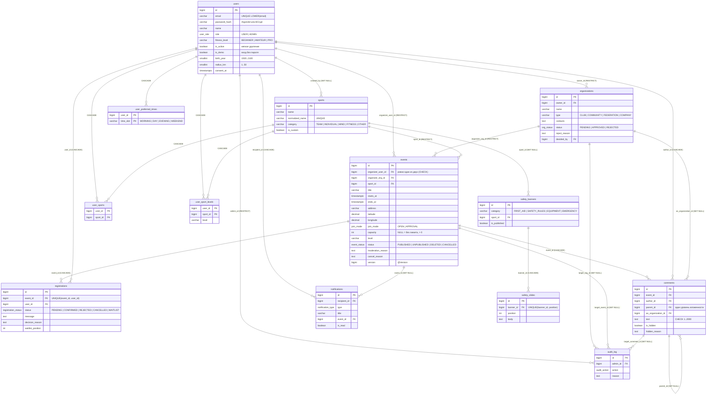

# Модель данных (ER)

Схема восстановлена по Flyway-миграциям `src/main/resources/db/migration/V01`–`V17` (состояние после `V17`). СУБД — PostgreSQL. В JPA-сущностях внешние ключи хранятся как числовые поля (`organizerUserId`, `sportId`, …) без `@ManyToOne`, поэтому связи ниже задаются только ограничениями в БД.

## Ключевые ограничения

| Ограничение | Где | Что гарантирует |
|---|---|---|
| `chk_one_organizer` | `events` (V04) | Организатор — либо пользователь, либо организация, не оба и не ни одного |
| `uq_registration (event_id, user_id)` | `registrations` (V05) | Одна запись пользователя на мероприятие; повторная заявка переиспользует строку |
| `uq_sports_normalized` | `sports` (V02) | Нет дублей направлений с разным регистром и пробелами |
| `uq_users_email ON LOWER(email)` | `users` (V01) | Email уникален без учёта регистра |
| `CHECK (capacity > 0)` | `events` | Лимит мест положительный или `NULL` |
| `CHECK (LENGTH(text) BETWEEN 1 AND 2000)` | `comments` | Нет пустых и слишком длинных сообщений |
| `ON DELETE RESTRICT` для владельца организации и организатора | `organizations`, `events` | Пользователя нельзя физически удалить, пока у него есть организации или мероприятия; приложение использует мягкое удаление (`is_active = false`) |
| `version` + `SELECT … FOR UPDATE` | `events` | Параллельные записи не превышают `capacity` (`EventRepository.findByIdForUpdate`) |

Таблица `registrations` в коде представлена сущностью `Participation` (`Models/Participation.java`).

Роль «представитель организации» отдельно не хранится: это любой `USER`, у которого есть строка в `organizations` с его `owner_id`. Права организации появляются, только когда её `status = APPROVED`.
